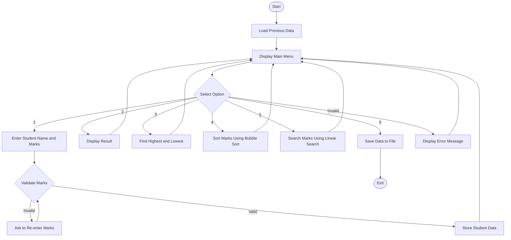
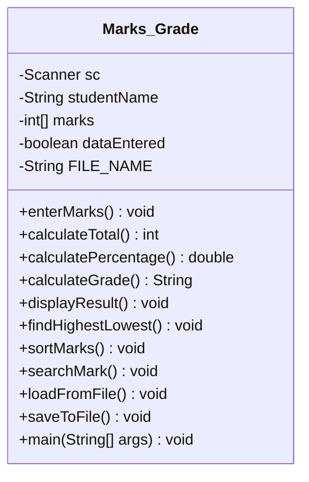

# 📊 Marks & Grade Calculator (Java)

A menu-driven, console-based Java application developed to simplify student result calculation and basic academic record management. The application calculates total marks, percentage and grades for five subjects. It also provides features to find the highest and lowest marks, sort marks in descending order, search for particular marks, and store student information using file handling.

The project demonstrates important Java programming concepts such as arrays, loops, methods, conditional statements, Bubble Sort, Linear Search, exception handling and file handling.

---

## 📌 Project Information

| Field | Details |
|---|---|
| Project Name | Marks & Grade Calculator |
| PS No. | 23 |
| Programming Language | Java |
| Project Type | Console-Based Application |
| Number of Subjects | 5 |
| IDE / Code Editor | VS Code / IntelliJ IDEA |
| File Storage | student_data.txt |

## 1. Abstract

The Marks & Grade Calculator is a console-based Java application developed to calculate the academic results of a student in five subjects. It calculates total marks, percentage and grade based on the marks entered by the user.

The application also provides features to find the highest and lowest scoring subjects, sort marks in descending order and search for a particular mark. It uses Java arrays, methods, Bubble Sort and Linear Search to perform these operations.

Additionally, the project uses file handling to save student information in a text file and load previously saved data when the application starts. Input validation is also implemented to prevent invalid marks and non-numeric values.

## 2. Introduction

The Marks & Grade Calculator is developed to simplify the process of calculating student results and reduce manual calculations. It allows users to enter their name and marks for five subjects. Based on the entered marks, the application automatically calculates the total marks, percentage and grade.

The application also provides useful features to analyze student performance. Users can find the highest and lowest marks, sort marks in descending order and search for a particular mark.

It also includes file handling functionality to save student information in a text file and load previously saved data whenever the application starts. Overall, the project makes result calculation easier, faster and more organized.

### Main Components

- **Marks_Grade Class:** Manages the complete application and student information.
- **Array:** Stores marks of five subjects.
- **Calculation Methods:** Calculate total marks, percentage and grade.
- **Sorting and Searching Methods:** Use Bubble Sort and Linear Search.
- **File Handling Methods:** Save and load student information.
- **Main Method:** Displays the menu and controls program execution.

## 3. Objectives

The main objectives of this project are:

- To develop a simple and user-friendly Marks & Grade Calculator using Java.
- To calculate the total marks and percentage of five subjects automatically.
- To calculate student grades based on overall percentage.
- To find the highest and lowest marks among five subjects.
- To sort marks in descending order (highest to lowest).
- To search for specific marks and identify their corresponding subjects.
- To save and load student records using file handling.
- To implement input validation and exception handling.

## 4. Project Scope

The scope of the Marks & Grade Calculator includes:

1. Entering the student's name and marks for five different subjects.
2. Automatically calculating total marks, percentage and grades.
3. Identifying the highest and lowest marks among all subjects.
4. Sorting marks in descending order.
5. Searching for specific marks and displaying the corresponding subject.
6. Saving student details and marks in a text file.
7. Loading previously saved student information automatically when the application starts.
8. Validating user input to handle incorrect entries, invalid marks and non-numeric values.

**Limitations:** The current version does not require a database, AI/ML, external APIs, user authentication, spell correction, fuzzy matching or personalization.

## 5. System Requirements

### Hardware Requirements

- Computer or laptop
- Minimum 4 GB RAM (recommended)
- Keyboard and monitor

### Software Requirements

- Operating System: Windows
- Programming Language: Java
- JDK: Java Development Kit (JDK 21, if installed)
- IDE / Code Editor: VS Code or IntelliJ IDEA
- Java Libraries: Java Standard Library (`java.util` and `java.io`)
- Storage: Text file (`student_data.txt`)

## 6. Features of the Project

| No. | Feature | Description |
|---|---|---|
| 1 | Enter Student Marks | Accepts student name and marks for five subjects. |
| 2 | Calculate Total | Calculates total marks out of 500. |
| 3 | Calculate Percentage | Calculates overall percentage. |
| 4 | Calculate Grade | Assigns grades according to percentage. |
| 5 | Display Result | Displays complete student result. |
| 6 | Highest & Lowest | Finds highest and lowest marks with subject numbers. |
| 7 | Sort Marks | Sorts marks from highest to lowest. |
| 8 | Search Marks | Searches for a particular mark. |
| 9 | Input Validation | Rejects marks outside 0–100 and non-numeric inputs. |
| 10 | File Handling | Saves and loads student information. |

## 7. Grading System

The application assigns grades according to the following percentage ranges:

| Percentage | Grade |
|---|---|
| 90% and above | A+ |
| 75% – 89% | A |
| 60% – 74% | B |
| 40% – 59% | C |
| Below 40% | F |

**Calculation Formulas**

Total Marks:

`Total = Subject1 + Subject2 + Subject3 + Subject4 + Subject5`

Maximum Marks:

`Maximum Marks = 5 × 100 = 500`

Percentage:

`Percentage = (Total Marks / 500) × 100`

The program calculates percentage using:

`calculateTotal() / 5.0`

## 8. Java Concepts Used

This project implements the following Java programming concepts:

### 8.1 Classes and Methods

The `Marks_Grade` class contains the complete program logic. Different methods are created to perform individual operations such as calculation, sorting, searching and file handling.

### 8.2 Arrays

An integer array is used to store marks of five subjects.

```java
static int[] marks = new int[5];
```

Array indexing starts from 0, so the five subjects are stored at indices 0 to 4.

### 8.3 Loops

For loops are used to accept marks, calculate totals, find highest and lowest marks, sort the array and search for a particular mark.

A while loop is used to repeatedly validate invalid marks until the user enters a valid value.

### 8.4 Conditional Statements

If-else statements are used to calculate grades, validate marks and identify the highest and lowest scoring subjects.

A switch statement is used to handle different menu options.

### 8.5 Methods

The program is divided into separate methods to make the code organized, readable and reusable.

### 8.6 Bubble Sort

Bubble Sort is used to arrange marks in descending order (highest to lowest). It compares adjacent elements and swaps them whenever the left element is smaller than the right element.

### 8.7 Linear Search

Linear Search is used to find a particular mark in the original array. It checks each subject's marks one by one and displays the corresponding subject number.

### 8.8 Exception Handling

Try-catch blocks handle non-numeric inputs and file-related errors. `NumberFormatException` is used when converting user input into integers.

### 8.9 File Handling

Java file handling is implemented using:

- `File` – Checks whether the data file exists.
- `Scanner` – Reads previously saved information.
- `PrintWriter` – Writes student information into the text file.

### 8.10 Menu-Driven Programming

A menu-driven interface allows users to select different operations using numeric choices. A while loop keeps the application running until the user selects Exit.

## 9. Methodology / Working Process

The application follows these steps:

1. The application starts and checks whether previously saved student data is available in `student_data.txt`.
2. If the file exists and contains valid data, the student name and marks are loaded automatically.
3. The application displays a menu containing different operations.
4. The user selects an option to enter student details and marks for five subjects.
5. The entered marks are validated to ensure they are numeric and within the range of 0 to 100.
6. Total marks, percentage and final grade are calculated using Java methods.
7. The highest and lowest marks are identified by comparing all five subject marks.
8. Marks are sorted in descending order using Bubble Sort.
9. The user can search for specific marks using Linear Search.
10. Student details and marks are saved in a text file when the user selects the Exit option.
11. The application displays appropriate messages for invalid inputs and successful operations.

### Program Flowchart

The following flowchart represents the overall working process:



## 10. Class Diagram

The class diagram illustrates the structure of the project and its main components. It shows the variables and methods used to perform different student result operations.



The `Marks_Grade` class manages the complete application. All the methods work together to enter, process, display and store student information.

## 11. Implementation and Method Explanation

The project is implemented in a single Java file named `Marks_Grade.java`.

### 11.1 Scanner and Variables

The following variables are used:

| Variable | Purpose |
|---|---|
| `sc` | Accepts user input. |
| `studentName` | Stores the student's name. |
| `marks[]` | Stores five subject marks. |
| `dataEntered` | Checks whether student data has been entered or loaded. |
| `FILE_NAME` | Stores the name of the data file. |

### 11.2 enterMarks()

- Takes the student's name as input.
- Accepts marks for all five subjects.
- Validates marks between 0 and 100.
- Handles non-numeric input using exception handling.
- Stores valid marks in an integer array.
- Sets `dataEntered` to true after successful entry.

### 11.3 calculateTotal()

Adds all five subject marks using a for-each loop and returns the total marks.

### 11.4 calculatePercentage()

Calculates the student's overall percentage by dividing total marks by 5.0.

### 11.5 calculateGrade()

Assigns a grade based on the calculated percentage using if-else conditions.

### 11.6 displayResult()

Displays the student's name, total marks out of 500, percentage and final grade.

### 11.7 findHighestLowest()

- Initializes highest and lowest values with the first subject's marks.
- Compares the remaining marks one by one.
- Updates the highest and lowest values.
- Displays the corresponding subject numbers.

### 11.8 sortMarks()

Uses Bubble Sort to arrange marks in descending order.

The original marks array is not modified because the method creates a copy using:

```java
int[] sorted = marks.clone();
```

### 11.9 searchMark()

Uses Linear Search to find the entered mark in the original marks array. If the mark is found, the corresponding subject number is displayed. It also supports finding the same mark in multiple subjects.

### 11.10 loadFromFile()

- Checks whether `student_data.txt` exists.
- Reads the previously saved student information.
- Separates the student name and marks using comma separation.
- Validates the number and range of marks.
- Loads valid information into the program.

### 11.11 saveToFile()

Uses `PrintWriter` to save the student name and five subject marks in a text file.

The data is saved when the user selects Exit.

### 11.12 main()

The main method controls the complete application. It loads previous data, displays the menu, accepts user choices and calls the corresponding methods using a switch statement.

## 12. Algorithms Used

### Bubble Sort Algorithm

1. Start with the first element of the array.
2. Compare two adjacent elements.
3. If the left element is smaller than the right element, swap them.
4. Continue comparing adjacent elements.
5. Repeat the process until the array is sorted in descending order.

**Example:**

Before sorting:

`80, 70, 90, 60, 100`

After sorting:

`100, 90, 80, 70, 60`

### Linear Search Algorithm

1. Accept the mark that needs to be searched.
2. Start checking from the first element.
3. Compare the search value with each subject's marks.
4. If a match is found, display its subject number.
5. Continue checking to identify other matching subjects.
6. If no match is found, display "Marks not found."

**Example:**

Search mark: `70`

Output: `70 found in Subject 2`

## 13. Time and Space Complexity

Let N represent the number of subjects. In this project, N = 5.

### Time Complexity

| Operation | Time Complexity |
|---|---|
| Entering Marks | O(N) |
| Calculating Total | O(N) |
| Calculating Percentage | O(1) |
| Calculating Grade | O(1) |
| Finding Highest and Lowest | O(N) |
| Sorting Using Bubble Sort | O(N²) |
| Searching Using Linear Search | O(N) |
| Saving Data to File | O(N) |
| Loading Data from File | O(N) |

### Space Complexity

- Marks Array: O(N)
- Temporary Sorting Array: O(N)
- Other variables: O(1)
- Auxiliary space used by sorting: O(N)

The sorting method uses an additional array to preserve the original marks.

## 14. Sample Input and Output

The following examples demonstrate the working of different features of the application.

### Test Case 1 – Normal Input

**Input:**

```text
Enter Your Choice: 1

Enter Student Name: Riya
Enter Subject 1 Marks: 80
Enter Subject 2 Marks: 70
Enter Subject 3 Marks: 90
Enter Subject 4 Marks: 60
Enter Subject 5 Marks: 100

Marks entered successfully!
```

**Display Result:**

```text
Enter Your Choice: 2

========== STUDENT RESULT ==========
Student Name: Riya
Total Marks: 400/500
Percentage: 80.0%
Grade: A
====================================
```

**Expected Result:** Total = 400, Percentage = 80.0%, Grade = A.

### Test Case 2 – Boundary / Minimum Input

**Input:**

```text
Enter Your Choice: 1

Enter Student Name: Aman
Enter Subject 1 Marks: 40
Enter Subject 2 Marks: 40
Enter Subject 3 Marks: 40
Enter Subject 4 Marks: 40
Enter Subject 5 Marks: 40

Marks entered successfully!
```

**Display Result:**

```text
========== STUDENT RESULT ==========
Student Name: Aman
Total Marks: 200/500
Percentage: 40.0%
Grade: C
====================================
```

**Expected Result:** Total = 200, Percentage = 40.0%, Grade = C (Pass).

### Test Case 3 – Invalid Input

**Input:**

```text
Enter Subject 1 Marks: 105

Invalid marks in Subject 1: 105
Please enter marks between 0 and 100.

Re-enter Subject 1 Marks: 85
```

**Expected Result:** The application rejects marks outside the valid range and asks the user to enter the marks again.

### Test Case 4 – Different Valid Scenario

**Input:**

```text
Riya's Marks:
80, 70, 90, 60, 100
```

**(a) Find Highest and Lowest:**

```text
Highest: Subject 5 (100)
Lowest: Subject 4 (60)
```

**(b) Sort Marks:**

```text
Marks in High to Low Order:
100 90 80 70 60
```

**(c) Search Marks:**

```text
Enter marks to search: 70

70 found in Subject 2
```

**Expected Result:** The application correctly identifies the highest and lowest marks, sorts marks in descending order and finds the searched mark.

### Test Case Summary

| Test Case | Scenario | Expected Output |
|---|---|---|
| TC-01 | Normal Input | 400/500, 80.0%, Grade A |
| TC-02 | Boundary / Minimum Input | 200/500, 40.0%, Grade C |
| TC-03 | Invalid Input | Rejects 105 and requests re-entry |
| TC-04 | Different Valid Scenario | Correct highest, lowest, sorting and searching |

**Result:** All four test cases produced the expected outputs successfully.

## 15. File Handling and Data Storage

The application uses a text file named `student_data.txt` to store student information.

### Data Storage Format

```text
Riya,80,70,90,60,100
```

The first value represents the student's name, followed by the five subject marks.

### Working Process

1. When the program starts, it checks whether the file exists.
2. If the file exists, previously saved information is loaded.
3. If the file does not exist, the application starts without previous data.
4. When the user selects Exit, the latest student information is saved.
5. The file is automatically created if it does not already exist.

**Note:** The current implementation stores one student's latest record in the text file.

## 16. Project Structure

```text
Marks-Grade-Calculator/
│
├── Marks_Grade.java
│
├── student_data.txt
│
└── README.md
```

**File Description:**

- `Marks_Grade.java` – Contains the complete Java source code.
- `student_data.txt` – Stores student name and marks.
- `README.md` – Contains project documentation and instructions.

Note: `student_data.txt` is generated automatically when the program saves student data.

## 17. How to Run the Project

### Step 1: Clone the Repository

```bash
git clone https://github.com/your-username/marks-grade-calculator-java.git
```

### Step 2: Open the Project Folder

```bash
cd marks-grade-calculator-java
```

### Step 3: Compile the Java Program

```bash
javac Marks_Grade.java
```

### Step 4: Run the Application

```bash
java Marks_Grade
```

## 18. Future Scope

The following improvements can be added in future versions of this project:

- Support for more than five subjects.
- Add, update and delete student records.
- Store student records in a database such as MySQL.
- Develop a Graphical User Interface (GUI).
- Generate student result reports in PDF or Excel format.
- Add student login and authentication functionality.
- Calculate class-wise results and compare student performance.
- Provide graphical representations of marks and overall performance.

These features are possible future enhancements and are not included in the current version.

## 19. Project Time Management

The project development was planned over seven days.

| Day | Work Description |
|---|---|
| Day 1 | Project planning and design |
| Day 2 | Java program structure and menu creation |
| Day 3 | Marks calculation and grade implementation |
| Day 4 | Highest-lowest, sorting and searching features |
| Day 5 | File handling (saving and loading student data) |
| Day 6 | Testing and error handling |
| Day 7 | Documentation and project demonstration |

## 20. Learning Outcomes

Through this project, I gained practical experience in:

- Writing and organizing Java programs.
- Working with arrays and loops.
- Creating and using methods.
- Implementing Bubble Sort and Linear Search.
- Applying conditional statements.
- Handling invalid inputs using exception handling.
- Reading and writing data using file handling.
- Developing menu-driven console applications.
- Testing and debugging Java programs.

## 21. Conclusion

The Marks & Grade Calculator project successfully provides a simple and efficient way to calculate and manage student marks using Java. It automates the calculation of total marks, percentage and grades while also providing features such as finding the highest and lowest marks, sorting and searching.

The use of file handling allows student records to be saved and loaded for future use. Input validation and exception handling help prevent invalid entries and improve the reliability of the application.

Overall, this project helped in understanding and applying important Java programming concepts, including arrays, loops, methods, sorting, searching, exception handling and file handling. It reduces manual calculations and makes basic student result management easier and more organized.

## 22. References

### Books

1. Herbert Schildt, *Java: The Complete Reference*, 12th Edition, McGraw Hill, 2021.
2. E. Balagurusamy, *Programming with Java: A Primer*, 6th Edition, McGraw Hill Education, 2019.

### Websites

3. [Oracle Java Documentation](https://docs.oracle.com/en/java/)
4. [W3Schools – Java Tutorial](https://www.w3schools.com/java/)
5. [GeeksforGeeks – Java Programming](https://www.geeksforgeeks.org/java/)
6. [Oracle Java Platform Documentation](https://www.oracle.com/java/technologies/)

---

## Author

**Meraj Husain**

B.Tech – Computer Science and Engineering (AI & ML)

Rungta International Skills University, Bhilai

**Project:** Marks & Grade Calculator (PS No. 23)

---

⭐ If you find this project useful, feel free to explore the repository!
